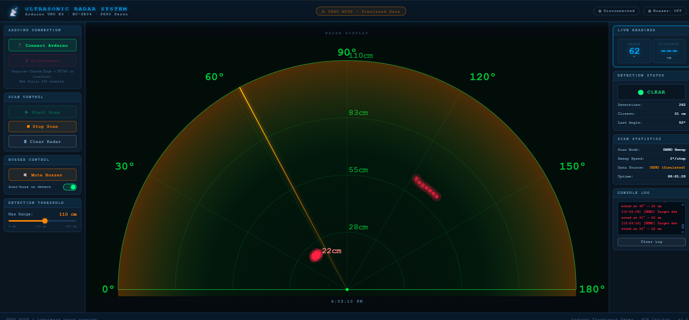
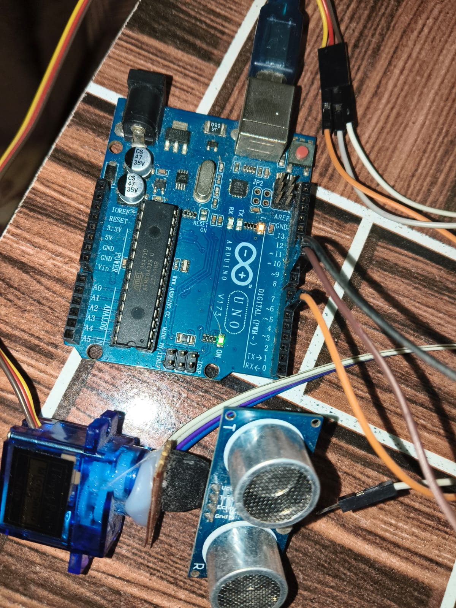

# 📡 Arduino Ultrasonic Radar System

[](https://www.arduino.cc/)
[](https://developer.mozilla.org/en-US/docs/Web/JavaScript)
[](https://developer.mozilla.org/en-US/docs/Web/HTML)
[](https://developer.mozilla.org/en-US/docs/Web/API/Web_Serial_API)
[](LICENSE)

A real-time **180° Ultrasonic Radar Detection & Visualization System** built using **Arduino UNO / Nano**, an **HC-SR04 ultrasonic distance sensor**, an **SG90 micro servo motor**, a **piezo buzzer**, and a modern **Web Serial browser dashboard**.

No third-party desktop runtime (such as Processing or Python serial bridges) is required. The web dashboard connects directly to the Arduino microcontroller via the modern browser **Web Serial API**.

---

## 📸 Visual Showcase & Working Prototype

### 🖥️ Sci-Fi Web Radar Dashboard
<div align="center">
  
  <p><em>Real-time military HUD web dashboard: 180° sweep line, calibrated distance rings, obstacle detection blips, live angle/distance telemetry, and control deck.</em></p>
</div>

### 🔌 Physical Hardware Assembly
<div align="center">
  
  <p><em>Physical prototype: Arduino UNO R3, HC-SR04 ultrasonic sensor mounted on SG90 servo horn, and piezo buzzer alarm.</em></p>
</div>

> 📹 **Live Demonstration Video:** Check out the working demonstration video in [`assets/radar_demo.mp4`](assets/radar_demo.mp4) showing real-time 180° sweeping and obstacle detection!

---

## ✨ Key Features

* **🔄 Full 180° Panoramic Sweep:** Servo motor rotates the ultrasonic sensor smoothly back and forth between `0°` and `180°`.
* **🎯 Accurate Distance Measurement:** HC-SR04 sonar module calculates distance (2 cm to 400 cm) in real time with high precision.
* **🌐 Native Web Serial Dashboard:** Plug-and-play USB connection directly through modern web browsers (Chrome / Edge) using `navigator.serial`.
* **🖥️ Sci-Fi Military HUD Radar UI:**
  * Animated sweep line with trailing phosphor gradient.
  * 4 concentric calibrated distance rings with radial spokes at 30° intervals.
  * Color-coded target blips that fade automatically over time.
  * Real-time angle (`0°–180°`), distance (`cm`), and closest obstacle statistics.
* **🔊 Smart Audio Alarm:**
  * Physical buzzer sound on target acquisition.
  * Web dashboard audio indicator + Software Mute / Unmute controls.
  * Auto-buzz toggle with configurable response.
* **🎚️ Dynamic Threshold Adjustment:** Real-time distance threshold slider (5 cm to 200 cm) synchronized bi-directionally between web UI and Arduino firmware.
* **🎮 Dual Mode Support:**
  * **Live Mode:** Real-time physical hardware telemetry.
  * **Simulation / Demo Mode:** Built-in virtual targets allowing offline testing without hardware connected.

---

## 🧰 Hardware Bill of Materials (BOM)

| Component | Quantity | Purpose | Operating Voltage |
|:---|:---:|:---|:---:|
| **Arduino UNO R3 / Nano** | 1 | Microcontroller & USB Serial Host | 5V DC (USB powered) |
| **HC-SR04** | 1 | Ultrasonic Distance Sensor (40 kHz sonar) | 5V DC (~15 mA) |
| **SG90 9g Micro Servo** | 1 | 180° Sweep Actuator | 4.8V – 6.0V |
| **5V Piezo Buzzer** | 1 | Audible Object Detection Alarm | 3.3V – 5V (< 30 mA) |
| **Breadboard & Jumper Wires** | 1 | Circuit interconnection & common ground rail | — |
| **100 µF – 470 µF Capacitor** *(Optional)* | 1 | Power rail buffer against servo motor voltage dips | ≥ 10V rated |

---

## 🔌 Circuit Diagram & Wiring Guide

All components share a **common ground rail** on the breadboard.

```
       +-----------------------------------------------------------+
       |                     ARDUINO UNO R3                        |
       |                                                           |
       |  [5V]  [GND]         [D6]        [D9]       [D10]   [D11] |
       +---|------|------------|-----------|-----------|-------|---+
           |      |            |           |           |       |
           |      |       (PWM Servo)   (Trig)      (Echo)  (Buzzer)
           |      |            |           |           |       |
           |   +--+----+       |           |           |       |
           |   |       |       |           |           |       |
         [5V] [GND]    |       |           |           |       |
        Breadboard     |       |           |           |       |
         Power Rails   |       |           |           |       |
           |      |    |       |           |           |       |
       +---|------|----+       |           |           |       |
       |   |      |            |           |           |       |
       |  VCC    GND         Signal        |           |       |
       |  [ SG90 SERVO ] <-----+           |           |       |
       |                                   |           |       |
       |  VCC    GND                      TRIG        ECHO     |
       |  [ HC-SR04 SENSOR ] <-------------+-----------+       |
       |                                                       |
       |  (+)    (-)                                           |
       |  [ PIEZO BUZZER ] <-----------------------------------+
```

### Complete Pin Connections Matrix

| Component | Component Pin | Arduino UNO Pin | Wire Type | Function |
|:---|:---|:---:|:---:|:---|
| **HC-SR04** | **VCC** | **5V** (Breadboard Rail) | M-F | 5V Sensor Power Supply |
| **HC-SR04** | **TRIG** | **Pin 9** *(or Pin 3)* | M-F | 10 µs Trigger Pulse Output |
| **HC-SR04** | **ECHO** | **Pin 10** *(or Pin 5)* | M-F | Echo Pulse Return Input |
| **HC-SR04** | **GND** | **GND** (Breadboard Rail) | M-F | Ground Reference |
| **SG90 Servo** | **VCC (Red)** | **5V** (Breadboard Rail) | M-M | Motor Power |
| **SG90 Servo** | **GND (Brown/Black)**| **GND** (Breadboard Rail) | M-M | Motor Ground |
| **SG90 Servo** | **Signal (Orange/Yellow)**| **Pin 6** | M-M | 50 Hz PWM Position Signal |
| **Buzzer** | **(+) / Long leg** | **Pin 11** | M-M | Tone PWM / Audible Alarm |
| **Buzzer** | **(−) / Short leg** | **GND** (Breadboard Rail) | M-M | Ground Reference |

> 💡 *Note: If you have wired your ultrasonic sensor to Pins 3 and 5 instead of 9 and 10, simply change `PIN_TRIG = 3;` and `PIN_ECHO = 5;` at the top of the Arduino sketch.*

---

## 📂 Project Directory Structure

```plaintext
Arduino-Ultrasonic-Radar/
├── assets/                          # Project media and visual assets
│   ├── dashboard.png                # High-resolution screenshot of web radar dashboard
│   ├── hardware_setup.jpeg          # Photo of the physical Arduino setup
│   └── radar_demo.mp4               # Video demo of the 180° sweep in action
├── arduino/                         # Microcontroller firmware
│   └── arduino_radar/
│       └── arduino_radar.ino        # Complete 180° radar Arduino sketch
├── dashboard/                       # Modern web frontend
│   ├── index.html                   # Semantic HTML5 layout & radar canvas
│   ├── script.js                    # Web Serial driver, renderer & simulation
│   └── style.css                    # Sci-Fi radar dark theme styling
├── docs/                            # In-depth technical documentation
│   ├── wiring.md                    # Hardware wiring guide & safety notes
│   └── testing.md                   # Systematic testing & validation checklist
├── .gitignore                       # Clean Git configuration
└── README.md                        # Master project documentation
```

---

## ⚡ Quick Start Guide (How to Run & Test on Your Laptop)

### Step 1: Upload Firmware to Arduino

1. Connect your Arduino UNO or Nano to your laptop/PC via USB cable.
2. Open the [Arduino IDE](https://www.arduino.cc/en/software).
3. Open the sketch file: [`arduino/arduino_radar/arduino_radar.ino`](arduino/arduino_radar/arduino_radar.ino).
4. Verify your wiring pins at the top of the file:
   ```cpp
   const int PIN_TRIG   = 9;   // HC-SR04 Trigger (Set to 9, or 3 if custom wired)
   const int PIN_ECHO   = 10;  // HC-SR04 Echo    (Set to 10, or 5 if custom wired)
   const int PIN_SERVO  = 6;   // SG90 Servo PWM signal (D6)
   const int PIN_BUZZER = 11;  // Piezo Buzzer positive (D11)
   ```
5. Select your board under **Tools → Board** (e.g. *Arduino Uno* or *Arduino Nano*).
6. Select your COM Port under **Tools → Port** (e.g. `COM3`, `COM4`, etc.).
7. Click **Upload** (Ctrl + U) and wait for *"Done uploading"*.
8. ⚠️ **Important:** Close the Arduino Serial Monitor window before proceeding to Step 2 (otherwise the browser cannot access the port).

---

### Step 2: Start the Web Dashboard Locally

> 💡 **Why a local server?** Modern Chromium browsers (**Google Chrome** and **Microsoft Edge**) require a secure origin (`localhost` or `127.0.0.1`) to grant Web Serial API permissions for hardware USB access.

Choose any of the following 3 easy methods to start the local server:

#### Method A: Using Python (Recommended — No installation needed if Python is installed)
Open **PowerShell** or **Command Prompt** (CMD) and run:
```bash
# Navigate to the dashboard directory
cd dashboard

# Start the local HTTP server on port 8080
python -m http.server 8080
```
Then open your browser and navigate to:
👉 **[http://localhost:8080](http://localhost:8080)**

#### Method B: Using VS Code (Live Server Extension)
1. Open the project folder in **VS Code**.
2. Right-click on [`dashboard/index.html`](dashboard/index.html).
3. Click **"Open with Live Server"**.
4. Your browser will automatically launch at `http://127.0.0.1:5500`.

#### Method C: Using Node.js
```bash
cd dashboard
npx serve -l 8080
```
Then visit **[http://localhost:8080](http://localhost:8080)**.

---

### Step 3: Connect & Test the Radar

#### 🧪 Option 1: Instant Offline Demo Test (Without Hardware)
Want to test the radar animations and features immediately without plugging in an Arduino?
1. Open **[http://localhost:8080](http://localhost:8080)** in Chrome or Edge.
2. Without clicking connect, simply click **`▶ Start Scan`**.
3. The dashboard will run in **Simulated Demo Mode**:
   * The radar beam will sweep from `0°` to `180°` and bounce back.
   * Virtual objects at **48° (22 cm)**, **88° (115 cm)**, and **128° (62 cm)** will be detected.
   * Try moving the **Detection Threshold Slider** from 30 cm to 120 cm to reveal distant targets!

#### 🔌 Option 2: Live Hardware Connection (With Arduino)
1. Ensure your Arduino is plugged into your laptop via USB.
2. Open **[http://localhost:8080](http://localhost:8080)** in **Google Chrome** or **Microsoft Edge**.
3. Click the green **`🔌 Connect Arduino`** button on the top-left card.
4. A browser permission popup will appear:
   * Select your Arduino device from the list (e.g. `USB-SERIAL CH340` or `Arduino Uno (COMx)`).
   * Click **Connect**.
5. Once connected:
   * The top status pill will turn green: **`● Connected`**.
   * Data Source will switch to: **`LIVE (Arduino)`**.
6. Click **`▶ Start Scan`**:
   * The SG90 servo motor will physically rotate from **0° to 180°**.
   * When an obstacle comes in front of the HC-SR04 sensor within your threshold, a **red glowing target dot** will appear on the canvas radar HUD, and the buzzer will sound!
   * Live angle and distance will update on the right-hand panel in real time.
7. To pause scanning at any moment, click **`■ Stop Scan`**, or click **`⏏ Disconnect`** to release the USB port cleanly.

---

## 📡 Serial Communication Protocol

The system uses a clean, line-delimited ASCII protocol operating at **9600 baud** over USB Serial:

### Arduino ➔ Dashboard (Telemetry)

| Message | Meaning | Example |
|:---|:---|:---|
| `DATA:<angle>,<dist>` | Normal sweep step, no obstacle within threshold | `DATA:90,45` (At 90°, dist is 45 cm) |
| `DETECT:<angle>,<dist>` | Object detected within active threshold | `DETECT:45,18` (Object detected at 45°, 18 cm) |
| `STATUS:<message>` | System status update (boot, sweep start, etc.) | `STATUS:180 degree radar sweep started` |
| `ERROR:<message>` | Sensor error or buffer overflow | `ERROR:Threshold out of range (5-200 cm)` |

### Dashboard ➔ Arduino (Commands)

| Command | Action |
|:---|:---|
| `START\n` | Starts servo 180° sweep and telemetry transmission |
| `STOP\n` | Halts servo sweep and silences buzzer |
| `MUTE\n` | Silences physical buzzer alerts |
| `UNMUTE\n` | Re-enables buzzer alarms |
| `THRESHOLD:<cm>\n` | Updates detection threshold distance (5–200 cm) |

---

## 🔧 Troubleshooting

<details>
<summary><b>1. Web Serial button does not open the port picker</b></summary>

* Make sure you are using a Chromium-based desktop browser (**Google Chrome** or **Microsoft Edge**). Firefox and Safari do not support the Web Serial API.
* Ensure you opened the dashboard via `http://localhost:8080` and **not** directly as a `file:///` URL.
</details>

<details>
<summary><b>2. "Port already open" or Arduino upload failed</b></summary>

* A serial port can only be opened by one program at a time.
* If you want to re-upload code via the Arduino IDE, disconnect the dashboard or close the browser tab first.
* Close the Arduino IDE Serial Monitor before connecting through the web dashboard.
</details>

<details>
<summary><b>3. Servo motor jitters or Arduino resets during sweep</b></summary>

* An SG90 servo can draw up to 250 mA peak during direction changes, which may cause a voltage drop on USB power.
* Add a **100 µF – 470 µF electrolytic capacitor** across the breadboard `5V` (+) and `GND` (−) rails.
* Ensure jumper wires are firmly seated in the breadboard.
</details>

---

## 👨‍💻 Author

* **Shubham Kumar** — [@shubhamjrd4559-sudo](https://github.com/shubhamjrd4559-sudo)

---

## 📄 License

This project is licensed under the **MIT License** — feel free to use, modify, and build upon it for academic, personal, or commercial projects.
